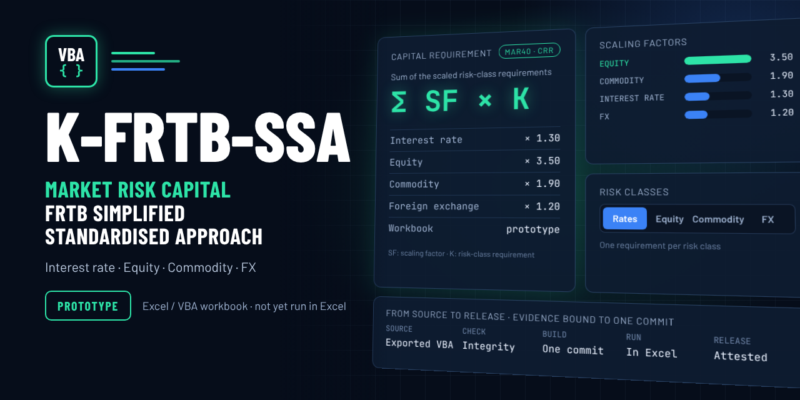
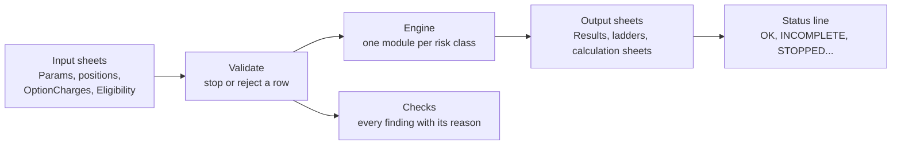
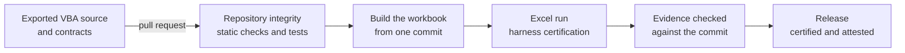

<div align="center">

# 📊 K-FRTB-SSA

### Market risk capital under the simplified standardised approach, in Excel VBA

**Basel MAR40 and EU CRR · Per-position audit trail · Exported VBA source · Reproducible builds · No real portfolio data**

<br>

[](#-vba-development)
[](#-requirements)
[](#-regimes)
[](#-status)
[](#-quality-gates)
[](#-quality-gates)
[](#-license)
<br>[](docs/repo_governance/TRAFFIC.md#badges)
[](docs/repo_governance/TRAFFIC.md#badges)
[](docs/repo_governance/TRAFFIC.md#badges)

<br>

**No add-in · No external reference · No DLL · No installer · Reviewable source for every calculation**

[Website](https://danielep71.github.io/K-FRTB-SSA/)
&nbsp;·&nbsp;
[What it is](#-what-this-project-is)
&nbsp;·&nbsp;
[Quick start](#-quick-start)
&nbsp;·&nbsp;
[How a run works](#-how-a-run-works)
&nbsp;·&nbsp;
[Regimes](#-regimes)
&nbsp;·&nbsp;
[Validation](#-validation)
&nbsp;·&nbsp;
[Limitations](#-known-limitations)
&nbsp;·&nbsp;
[Methodology](docs/methodology/README.md)
&nbsp;·&nbsp;
[Documentation](#-documentation)

---

<p align="center">
  
</p>

---

</div>

> [!IMPORTANT]
> **No version has been released, and the workbook is a prototype.** I have
> run it only in LibreOffice's VBA mode: it has not been compiled or run in
> Excel, and no evidence of an Excel run is recorded here. The Basel rules
> are checked against the values MAR40 and the Basel Committee publish; the
> **CRR regime is implemented but not validated**, because I found no
> published worked example and no independent implementation to compare it
> with. Do not use a result for regulatory reporting, and do not read it as a
> statement of compliance with the Basel Framework or the CRR
> ([what has been checked](#-validation)).

> [!NOTE]
> The workbook is **not stored in the repository as a macro-enabled file**. It
> is built from the macro-free template `src/workbook/Template.xlsx` and the
> exported VBA source, so every line of calculation code is reviewable in a
> pull request.

<a id="-what-this-project-is"></a>

## ✨ What this project is

The **simplified standardised approach** is the way a bank with a small
trading book calculates the own funds requirement for market risk without the
sensitivities-based method: four charges, one per risk class, each scaled
and summed.

```text
Requirement = 1.30 × IR + 3.50 × EQ + 1.90 × CO + 1.20 × FX     (non-delta option charges included)
RWA         = 12.5 × Requirement
Under the CRR regime, Requirement × 0.9 up to 2029-12-31 (transitional multiplier)
```

**K-FRTB-SSA** is an Excel/VBA implementation of it. You enter positions on
the input sheets; the engine slots each one, nets and offsets it, and writes
the requirement per risk class with every intermediate value behind it. It is
built for people who need to **check** a number as well as produce one:

- each position's weight, charge and status is visible on `IRCalc`, `EQCalc`,
  `COCalc` and `FXCalc`;
- each ladder, zone offset, market, commodity and currency total is visible on
  `IR_Ladder`, `IR_Zones` and `Buckets`;
- every rejected row is listed on `Checks` with the reason and is excluded from
  the totals, and the status line says `INCOMPLETE` instead of presenting a
  partial portfolio as a whole one;
- every rule is traced to its paragraph of MAR40 or its article of the CRR in
  the [calculation contracts](docs/methodology/CALCULATION_CONTRACTS.md).

<a id="-core-capabilities"></a>

## 🎯 Core capabilities

| Area | Capability |
| --- | --- |
| Regimes | Basel MAR40 (default) and EU CRR in one engine, chosen by the `Regime` parameter; the headline of `Results` says which one produced the figures |
| Risk classes | Interest rate (specific and general market risk by the maturity method), equity, commodities (simplified approach) and foreign exchange, gold included |
| Requirement | The four charges and the non-delta option charges you enter, scaled and summed; risk-weighted assets as 12.5 times the requirement; the CRR's transitional multiplier on its own row |
| CRR specifics | Specific risk by risk weight (Article 336), 150% between zones 1 and 3 (Article 339), no index charge (Article 344), the de minimis of Article 351, the size conditions of Articles 325a and 94 |
| Input validation | Unusable parameters stop the run; a bad row is rejected with its reason; nothing is silently read as blank. A run on more than 500 rows of a sheet stops |
| Status and staleness | A status line on every output sheet, and a check that says whether the results shown are those of the inputs now on the sheets |
| Worksheet functions | Four `FRTBSSA_*` functions for the building blocks, returning Excel errors for invalid inputs |
| Deployment | Plain exported VBA and a macro-free template; no add-in, COM component, DLL or extra VBA reference |
| Testing | 49 registered numerical cases, VBA suites under a test harness, static checks of the VBA in CI, and an offline check that the evidence of an Excel run matches one commit |
| Reproducibility | Tools that build the workbook from the source of one commit, byte for byte |

The [support matrix](docs/methodology/README.md#support-matrix) lists what is
supported, what you must enter, and what is out of scope.

<a id="-quick-start"></a>

# ⚡ Quick start

No workbook is released: you build one from source.

## 1. Clone and check

```sh
git clone https://github.com/danielep71/K-FRTB-SSA.git
cd K-FRTB-SSA
python tools/check_repository.py
```

Use a clone, not **Download ZIP** or GitHub's **Raw** view: a clone checks the
VBA out with the CRLF line endings the VBE expects. The checks need Python 3.11
or later and a few packages; the
[contributing guide](CONTRIBUTING.md#-local-checks) lists them.

## 2. Build the workbook

```sh
python tools/devbuild/build_workbook.py --configuration production
```

It writes `test-results/build/Workbook-production.xlsm`, which Git ignores:
the 19 sheets of the template, the VBA modules of `src/` and a build stamp with
the commit. The `development` configuration adds the test modules. Open the
workbook, enable macros and compile it (**Alt+F11**, then **Debug → Compile
VBAProject**); [`INSTALLATION.md`](INSTALLATION.md) gives the host policy, the
references and the troubleshooting.

## 3. Run

The template ships synthetic sample data, which includes the published example
of table 9 of MAR40.61. Press **Alt+F8** and run:

| Macro | What it does |
| --- | --- |
| `RunSSA` | Reads every input, calculates, writes every output sheet and shows a summary |
| `ClearOutputs` | Empties the output sheets and sets the status to not calculated |
| `CheckStatus` | Tells you whether the results shown are those of the inputs on the sheets |

`RunSSA_Silent`, `ClearOutputs_Silent` and `CheckStatus_Silent` do the same
without a message box. To calculate under the CRR, set `Regime` to `CRR` on
`Params`, enter the total own funds, and read the
[prototype guide](docs/PROTOTYPE.md) for the category and the rating grade of
a debt position under that regime.

## 4. Test

```sh
python tools/run_tests.py
```

runs the Python tests, one module per process. The workbook's own VBA tests
are four suites of the [test harness](docs/methodology/TEST_HARNESS.md), each
with a certification entry point; recording an Excel run is described in
[`INSTALLATION.md`](INSTALLATION.md). The tests write to the input and output
sheets: never run them on real data.

<a id="-how-a-run-works"></a>

# 🔄 How a run works



The workbook has 19 sheets, all visible and protected without a password:

| Kind | Sheets | What you do |
| --- | --- | --- |
| Reference | `Home`, `README` | Read them. They hold the conventions, the limits and the build stamp |
| Input | `Params`, `IRPositions`, `EQPositions`, `COPositions`, `FXPositions`, `OptionCharges`, `Eligibility` | Type in the yellow cells, and on `Params` the grey cells of the constants |
| Output | `Results`, `IR_Zones`, `IR_Ladder`, `Buckets`, `IRCalc`, `EQCalc`, `COCalc`, `FXCalc` | Read them. A run replaces their content |
| Diagnostics | `Checks`, `TestCatalogue` | Read them: the findings of a run, and the sample data against expected values |

The status line of `Results`, which every output sheet repeats, is the state
of the last run:

| Begins | Meaning |
| --- | --- |
| `Not calculated` | The output sheets are empty |
| `OK` | Every input row was used |
| `INCOMPLETE` | Some rows were rejected and are excluded from the totals; `Checks` lists each |
| `STOPPED` | A parameter is unusable: nothing was calculated |
| `FAILED` | The run raised an error: the output sheets are empty |
| `OUTDATED` | An input changed after the run: run again before you read the results |

The workbook converts nothing for you: a derivative is a row for each leg, and
the category and rating of an issuer, the delta of an option and the net open
position of a currency are inputs. [The prototype guide](docs/PROTOTYPE.md)
describes each sheet, and the [workbook contract](docs/methodology/WORKBOOK_CONTRACT.md)
defines the layout.

<a id="-regimes"></a>

# ⚖️ Regimes

The Basel regime, MAR40, is the default. The `CRR` regime is the simplified
standardised approach of Article 325(2) of Regulation (EU) No 575/2013, as
amended by Regulation (EU) 2024/1623, with the articles it points to. It
shows what the EU text changes, and every result says which regime it used.

| Topic | Basel MAR40 | EU CRR |
| --- | --- | --- |
| Requirement | The scaled charges, summed | The same, multiplied by 0.9 up to 2029-12-31 (Article 495s(2)), with its own row on `Results` |
| Specific risk of debt | Table 1 of MAR40.6, by category and rating grade | Article 336, by the risk weight the issuer would have under the credit-risk standardised approach (`RW 0%` to `RW 150%`); a weight of 75% is charged as 100% by my decision |
| General market risk of debt | Maturity method; zones 1 and 3 offset at 100% | Maturity method of Article 339; zones 1 and 3 offset at **150%** |
| Equity index | A further 2% | No charge of its own (Article 344) |
| Foreign exchange | 8% of the overall net open position, gold included | Zero while that position is at most 2% of your total own funds (Article 351) |
| Size of the business | Not read | Articles 325a and 94: from the months you enter, each approach is `MET`, `NOT MET` or `CEASE`, a finding that changes no requirement |
| Commodities | Simplified approach: 15% of the net and 3% of the gross position | The same, Article 360 |

[`CRR_COMPARISON.md`](docs/methodology/CRR_COMPARISON.md) compares every rule
of the contracts with the CRR and names the issue that takes each difference.

**Not supported under the CRR, and reported rather than calculated silently
where an input can say so:** the duration method (Article 340), the cap of
Article 335, the reversal of the first two zone offsets (Article 339(6)), the
collective investment undertakings of Article 348, the commodity maturity
ladders (Articles 359 and 361), ancillary agricultural business (Article 356),
the closely correlated currencies of Article 354, the exclusions of Article
104c, securitisation and credit derivatives. Under the CRR you enter the
delta-equivalent position of every option, and the non-delta charge with the
delta already deducted.

<a id="-validation"></a>

# ✅ Validation

| Class | Meaning | Used for |
| --- | --- | --- |
| `published` | A value printed in MAR40 or in the Basel Committee's 2005 update of its 1996 market risk amendment, checked against the text | Three cases: the example of table 9 of MAR40.61, the vertical disallowance of MAR40.27 and the maturity-method example |
| `illustrative` | A derivation of mine, separate from the code under test, written from the contracts | The other 46 cases; it never counts as validation |

- **49 registered cases** cover the calculations, the limits, the invalid
  inputs and the CRR rules; 47 run in the workbook's `cases` suite, with 874
  assertions, and the same cases run against the formula workbook and the
  Python derivation, which must agree.
- **No CRR value is validated.** Every value of the `CRR` regime is
  `illustrative`. The search for a published worked example or an independent
  implementation, recorded in [`SOURCES.md`](docs/methodology/SOURCES.md), found
  none. The draft accuracy contract `ACC-04` cannot be frozen until three
  holdout cases hold `published` or `independent` values.
- **Excel is untested.** Nothing has been compiled or run in Excel; the suites
  passed in LibreOffice only. The [host behaviour](docs/methodology/VALIDATION_PLAN.md#host-behaviour)
  table lists what the code relies on Excel to do, and which of it has been
  measured.

The [validation plan](docs/methodology/VALIDATION_PLAN.md) gives the status of
each rule, and the [test cases guide](docs/methodology/TEST_CASES.md) says how
a case is written and when a rule counts as validated.

<a id="-worksheet-functions"></a>

# 🧩 Worksheet functions

Four functions calculate from their arguments and read no sheet. An input
outside a function's domain gives an error value. The
[public API inventory](docs/PUBLIC_API.txt) lists the supported entry points;
everything else under `src/` may change without notice.

| Function | Gives | Reference |
| --- | --- | --- |
| `FRTBSSA_TimeBand(ResidualMaturity, Coupon, Floating)` | The time band of a position | Table 4 of MAR40.26; CRR Article 339 |
| `FRTBSSA_LadderCharge(WeightedLong, WeightedShort)` | The general market risk charge of one ladder | MAR40.27 to 40.40 |
| `FRTBSSA_FXCharge(SumNetLong, SumNetShort, GoldPosition)` | The foreign exchange charge | Table 9 of MAR40.61 |
| `FRTBSSA_CommodityCharge(NetPosition, GrossPosition)` | The commodity charge | MAR40.64 to 40.73 |

<a id="-from-source-to-release"></a>

# 🔄 From source to release

Each step leaves something a later step, or a reviewer, can check:



| Step | Tool or record | What it proves |
| --- | --- | --- |
| Change | Pull request, with the [final-head review](docs/repo_governance/PULL_REQUESTS.md) | The reviewed commit is the one merged |
| Check | `python tools/check_repository.py` | Every **Repository integrity** check passes locally as in CI |
| Build | `tools/devbuild/build_workbook.py` | The workbook comes from the source of one commit, byte for byte reproducible |
| Run | `tools/devbuild/excel_run.py` | The harness certification ran in Excel, with a host record |
| Evidence | `python tools/check_excel_run.py` | The run's logs and results match the commit and the evidence policy |
| Release | [RELEASING.md](RELEASING.md), `python tools/release.py` | The tag, the changelog, the certification and the published assets agree |

<a id="-quality-gates"></a>

# 🛡️ Quality gates

| Workflow | When it runs | What it checks |
| --- | --- | --- |
| **Repository integrity** | Every pull request, and pushes to the default branch and release branches; the required check | Python, VBA, workflow, link, changelog, test-case and governance checks, with the unit tests; also on the minimum supported Python |
| **CodeQL** | Pushes, pull requests and weekly | Code scanning of the Python, JavaScript and workflow code |
| **OpenSSF Scorecard** | Pushes to the default branch and weekly | The repository's supply-chain posture |
| **Link check** | Weekly | External links |
| **Sync issue labels** · **Detect issue-label drift** | Catalogue changes · daily | The live labels against `.github/labels.json`, never deleting one in use |
| **Detect settings drift** | Daily | The live rulesets and the other settings a read-only token can read against `docs/setup/repository-settings.json`; the rest is listed as not checked |
| **Issue triage** | Issue and milestone events | Assignee, one priority, an open milestone, a target end date and a dependency section on every open issue |
| **Keep milestones issue-only** | Pull request events and daily | Removes any milestone set on a pull request, and lists each removal |
| **Release** | A pushed `vX.Y.Z` tag | Verifies the tag, builds a reproducible source bundle, attests it where the repository allows it and drafts the release |
| **Traffic history** | Daily | Collects clones and visitors for the badges above |

Static checks of the exported VBA cover layout, names, `#If` structure, jump
targets, visibility, dependency direction, identifiers, `Err` copies, native
declarations and calls; Python is held to Ruff, strict mypy and actionlint.

<a id="-vba-development"></a>

# 🧩 VBA development

- The [repository structure](docs/REPOSITORY_STRUCTURE.md) says where each VBA
  component lives and which may call which.
- The [house style](docs/VBA_HOUSE_STYLE.md) covers naming, contracts, errors
  and cleanup.
- The [public API inventory](docs/PUBLIC_API.txt) lists the supported entry
  points, and every other public declaration under `src/`.
- The [installation guide](INSTALLATION.md) moves source between the
  repository and Excel, and covers upgrades, troubleshooting and removal.

## 📦 Repository structure

```text
.github/   workflows, issue forms, labels, Dependabot and the Excel evidence policy
docs/      methodology, release records, governance, setup, house style, licenses
tests/     VBA harness and suites, test cases, accuracy contracts, Python tests
tools/     static checks, workbook build and Excel run, release and settings setup
src/       the workbook's VBA source and macro-free template
```

The full layout and its rules are in
[`docs/REPOSITORY_STRUCTURE.md`](docs/REPOSITORY_STRUCTURE.md).

<a id="-requirements"></a>

# 💻 Requirements

Microsoft 365 Excel desktop on Windows, 64-bit, with the default VBA
references and macros enabled in the workbook; Python 3.11 or later for the
repository tooling. LibreOffice is an early warning, not a supported host.
[`INSTALLATION.md`](INSTALLATION.md#%EF%B8%8F-host-policy) records the policy.

<a id="-known-limitations"></a>

# ⚠️ Known limitations

- **Prototype.** No version is released, nothing has run in Excel, and no
  rule is validated for regulatory reporting.
- **The CRR regime is not validated.** Its values are `illustrative`, no Excel
  evidence exists for it, and some of its rules rest on my reading of the text:
  the treatment of gold in the de minimis, the weight of 75% charged as 100%,
  and the value of a non-trading book position, because the technical
  standards of Article 325(9) cover the alternative approaches only.
- **Options, derivatives and issuers are inputs.** The workbook converts no
  derivative into positions, derives no delta, and applies no criterion to
  classify an issuer; the non-delta charge of options is a value you enter.
- **Out of scope:** securitisation, credit derivatives and the correlation
  trading portfolio (nothing identifies one: entered as a debt position, it is
  calculated as one, so do not enter it), national discretions, and the
  sensitivities-based method.
- **Non-trading book:** foreign exchange and commodity rows are calculated as
  trading book ones; interest rate and equity rows are excluded with a warning.
- **500 rows per position sheet.** A run on more stops.
- **Windows desktop Excel only.**

The full list is in the
[support matrix](docs/methodology/README.md#support-matrix).

<a id="-status"></a>

# 📌 Status

No version has been released. The release state is recorded in one place: the
[*Current status*](RELEASING.md#current-status) of `RELEASING.md`, which
**Repository integrity** checks against [`CHANGELOG.md`](CHANGELOG.md). The
current work is the milestone *v0.3.0 - CRR regime*, on the release branch
`release/0.3.0`; changes reach `main` through task branches and pull requests,
and only a release is versioned and tagged.

<a id="-documentation"></a>

# 📚 Documentation

| Document | Covers |
| --- | --- |
| [`docs/PROTOTYPE.md`](docs/PROTOTYPE.md) | The prototype for the person who uses it: what it calculates, the sheets and inputs, how to run it, how to build it, what it does not do and what has been checked |
| [`docs/methodology/`](docs/methodology/README.md) | Sources, data contract, calculation and workbook contracts, the comparison with the CRR, test cases, test harness, validation plan |
| [`INSTALLATION.md`](INSTALLATION.md) | Moving source between the repository and Excel, recording an Excel run, upgrades, troubleshooting and removal |
| [`docs/REPOSITORY_STRUCTURE.md`](docs/REPOSITORY_STRUCTURE.md) | Source layout, reserved paths, dependency direction |
| [`docs/VBA_HOUSE_STYLE.md`](docs/VBA_HOUSE_STYLE.md) | VBA naming, contracts, errors, cleanup and static checks |
| [`docs/repo_governance/`](docs/repo_governance/README.md) | Settings, issue labels, pull requests, traffic, distribution |
| [`docs/WEBSITE.md`](docs/WEBSITE.md) | The [project website](https://danielep71.github.io/K-FRTB-SSA/): its files, publication and maintenance |
| [`docs/setup/REPOSITORY_SETUP.md`](docs/setup/REPOSITORY_SETUP.md) | Previewing, applying and verifying the GitHub settings baseline, and what to keep, adapt or remove |
| [`RELEASING.md`](RELEASING.md) | How a version is prepared, certified and published, and the current status |
| [`docs/release/`](docs/release/CLOSEOUT.md) | The milestone [closeout](docs/release/CLOSEOUT.md) and the [release certification](docs/release/RELEASE_CERTIFICATION.md) records, and the [maintenance audit](docs/release/MAINTENANCE_AUDIT.md) done before each release |
| [`CONTRIBUTING.md`](CONTRIBUTING.md) | Workflow, checks, rules of evidence and pull requests |
| [`SECURITY.md`](SECURITY.md) | Private vulnerability reporting, runtime risk surface and data handling |
| [`CODE_OF_CONDUCT.md`](CODE_OF_CONDUCT.md) | Participant behaviour and conduct reporting |
| [`CHANGELOG.md`](CHANGELOG.md) | Change history |

<a id="-data-and-security"></a>

# 🔐 Data and security

No real portfolio data: never commit or attach real trades, positions,
counterparty data, or any client or employer material. VBA runs with the
user's Office permissions: review the source and follow your organisation's
macro policy. Report suspected vulnerabilities privately as described in
[`SECURITY.md`](SECURITY.md).

# 🧭 Contributing

To take part, read the [contributing guide](CONTRIBUTING.md) and the
[code of conduct](CODE_OF_CONDUCT.md).

# 👤 Author

**Daniele Penza** — [@danielep71](https://github.com/danielep71)

<a id="-license"></a>

# 📄 License

This repository is licensed under the [Mozilla Public License 2.0](LICENSE).
The files listed in [`docs/licenses/`](docs/licenses/THIRD_PARTY_NOTICES.txt)
keep the license the notice states for them, MPL-2.0 or MIT.
