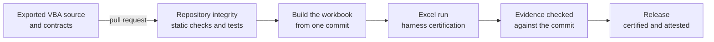

<div align="center">

# 📊 K-FRTB-SSA

### An Excel VBA workbook for the FRTB simplified standardised approach

**Market risk capital · Exported VBA source · Reproducible builds · Excel-run evidence · Governed releases**

<br>

[](#-vba-development)
[](INSTALLATION.md)
[](#-quality-gates)
[](#-quality-gates)
[](#-license)
<br>[](docs/repo_governance/TRAFFIC.md#badges)
[](docs/repo_governance/TRAFFIC.md#badges)
[](docs/repo_governance/TRAFFIC.md#badges)

<br>

**Text-first and reviewable: exported VBA, JSON contracts and Markdown evidence, every change through a pull request**

[What it is](#-what-this-repository-is)
&nbsp;·&nbsp;
[Status](#-status)
&nbsp;·&nbsp;
[What is in place](#-what-is-in-place)
&nbsp;·&nbsp;
[Lifecycle](#-from-source-to-release)
&nbsp;·&nbsp;
[Quality gates](#-quality-gates)
&nbsp;·&nbsp;
[Documentation](#-documentation)

---

</div>

## ✨ What this repository is

I use this repository to build an Excel workbook that calculates the market
risk capital requirement under the simplified standardised approach of the
Fundamental Review of the Trading Book (FRTB). The workbook is not stored as
a macro-enabled file: it is built from exported VBA source and an optional
macro-free template, so every line of calculation code is reviewable in a
pull request, and every Excel run leaves evidence that a check binds to one
commit.

## 📌 Status

No version has been released, and the repository holds no calculation yet:

| Area | State |
| --- | --- |
| Calculation | Not started. There is no VBA source under `src/` and no workbook to install |
| Methodology | The [guides](docs/methodology/README.md) are in place with illustrative rows. The FRTB sources, the data contract and the calculation contracts are still to be written |
| Test cases | The format, its checks and illustrative cases are in place. No FRTB test case exists yet |
| Tooling and governance | In use: every change goes through a pull request that **Repository integrity** checks |

The release state is recorded in one place: the
[*Current status*](RELEASING.md#current-status) of `RELEASING.md`, which
**Repository integrity** checks against [`CHANGELOG.md`](CHANGELOG.md).
Changes reach `main` through task branches and pull requests; only a release
is versioned and tagged.

## 🎯 What is in place

| Area | What the repository holds |
| --- | --- |
| Source control for Excel | Editing and Git policies for workbooks, exported VBA source and byte-preserved regulatory source copies |
| VBA quality | Static checks of exported VBA (layout, names, `#If` structure, jump targets, visibility, dependency direction, identifiers, `Err` copies, native declarations, calls) and a layout formatter, run on every change |
| Reproducible builds | Tools that build a macro-enabled workbook from the source of one commit, without *Trust access to the VBA project object model*, and bind an export to the workbook it came from |
| Testing and evidence | A VBA test harness with a certification entry point, the numerical test-case and accuracy-contract formats, and an offline check that the evidence of an Excel run matches one commit |
| Methodology | Guides for the sources, the data contract, the calculation and workbook contracts and the validation plan, with a traceability table from each rule to its tests |
| Python quality gates | Ruff, strict mypy and actionlint, plus tests that hold the workflows to pinned actions, explicit permissions and the required check |
| Links | Relative links, anchors and HTTPS on every change; external links weekly |
| Issues and pull requests | Issue labels, issue forms, triage automation, a pull request template with a final-head review, and a workflow that keeps milestones on issues only |
| GitHub settings | A documented settings baseline (general settings, security features, rulesets, Actions settings) that a script previews, applies and verifies; the [setup record](docs/repo_governance/SETTINGS_EVIDENCE.md) shows the last verified state |
| Security | A security policy, a review to record before distribution, CodeQL scanning of the Python, JavaScript and workflow code, an OpenSSF Scorecard measure, and Dependabot updates for the pinned Actions and the hash-locked Python dependencies |
| Releases | A release process with a changelog, a certification record, a milestone closeout and a reproducible, attested source bundle |
| Traffic | Daily collection of clones and visitors, with the badges above |

## 🔄 From source to release

Each step leaves something a later step, or a reviewer, can check:



| Step | Tool or record | What it proves |
| --- | --- | --- |
| Change | Pull request, with the [final-head review](docs/repo_governance/PULL_REQUESTS.md) | The reviewed commit is the one merged |
| Check | `python tools/check_repository.py` | Every **Repository integrity** check passes locally as in CI |
| Build | `tools/devbuild/build_workbook.py` | The workbook comes from the source of one commit, byte for byte reproducible |
| Run | `tools/devbuild/excel_run.py` | The harness certification ran in Excel, with a host record |
| Evidence | `python tools/check_excel_run.py` | The run's logs and results match the commit and the evidence policy |
| Release | [RELEASING.md](RELEASING.md), `python tools/release.py` | The tag, the changelog, the certification and the published assets agree |

## ✅ Quality gates

| Workflow | When it runs | What it checks |
| --- | --- | --- |
| **Repository integrity** | Every push and pull request; the required check | Python, VBA, workflow, link, changelog, test-case and governance checks, with the unit tests; also on the minimum supported Python |
| **CodeQL** | Pushes, pull requests and weekly | Code scanning of the Python, JavaScript and workflow code |
| **OpenSSF Scorecard** | Pushes to the default branch and weekly | The repository's supply-chain posture |
| **Link check** | Weekly | External links |
| **Sync issue labels** · **Detect issue-label drift** | Catalogue changes · daily | The live labels against `.github/labels.json`, never deleting one in use |
| **Detect settings drift** | Daily | The live rulesets and the other settings a read-only token can read against `docs/setup/repository-settings.json`; the rest is listed as not checked |
| **Issue triage** | Issue and milestone events | Assignee, one priority, an open milestone, a target end date and a dependency section on every open issue |
| **Keep milestones issue-only** | Pull request events and daily | Removes any milestone set on a pull request, and lists each removal |
| **Release** | A pushed `vX.Y.Z` tag | Verifies the tag, builds a reproducible source bundle, attests it where the repository allows it and drafts the release |
| **Traffic history** | Daily | Collects clones and visitors for the badges above |

## 🧩 VBA development

- The [repository structure](docs/REPOSITORY_STRUCTURE.md) says where each VBA
  component lives and which may call which.
- The [house style](docs/VBA_HOUSE_STYLE.md) covers naming, contracts, errors
  and cleanup.
- The [public API inventory](docs/PUBLIC_API.txt) lists the supported entry
  points, and every other public declaration under `src/`.
- The [installation guide](INSTALLATION.md) moves source between the
  repository and Excel, and covers upgrades, troubleshooting and removal.

## 📦 Repository structure

```text
.github/   workflows, issue forms, labels, Dependabot and the Excel evidence policy
docs/      methodology, release records, governance, setup, house style, licenses
tests/     VBA harness and example suite, test cases, accuracy contracts, Python tests
tools/     static checks, workbook build and Excel run, release and settings setup
src/       the workbook's VBA source and macro-free template (reserved: not added yet)
```

The full layout and its rules are in
[`docs/REPOSITORY_STRUCTURE.md`](docs/REPOSITORY_STRUCTURE.md).

## 📚 Documentation

| Document | Covers |
| --- | --- |
| [`docs/methodology/`](docs/methodology/README.md) | Sources, data contract, calculation and workbook contracts, test cases, test harness, validation plan |
| [`INSTALLATION.md`](INSTALLATION.md) | Moving source between the repository and Excel, recording an Excel run, upgrades, troubleshooting and removal |
| [`docs/REPOSITORY_STRUCTURE.md`](docs/REPOSITORY_STRUCTURE.md) | Source layout, reserved paths, dependency direction |
| [`docs/VBA_HOUSE_STYLE.md`](docs/VBA_HOUSE_STYLE.md) | VBA naming, contracts, errors, cleanup and static checks |
| [`docs/repo_governance/`](docs/repo_governance/README.md) | Settings, issue labels, pull requests, traffic, distribution |
| [`docs/setup/REPOSITORY_SETUP.md`](docs/setup/REPOSITORY_SETUP.md) | Previewing, applying and verifying the GitHub settings baseline, and what to keep, adapt or remove |
| [`RELEASING.md`](RELEASING.md) | How a version is prepared, certified and published, and the current status |
| [`docs/release/`](docs/release/CLOSEOUT.md) | The milestone [closeout](docs/release/CLOSEOUT.md) and the [release certification](docs/release/RELEASE_CERTIFICATION.md) records, and the [maintenance audit](docs/release/MAINTENANCE_AUDIT.md) done before each release |
| [`CONTRIBUTING.md`](CONTRIBUTING.md) | Workflow, checks, rules of evidence and pull requests |
| [`SECURITY.md`](SECURITY.md) | Private vulnerability reporting, runtime risk surface and data handling |
| [`CODE_OF_CONDUCT.md`](CODE_OF_CONDUCT.md) | Participant behaviour and conduct reporting |
| [`CHANGELOG.md`](CHANGELOG.md) | Change history |

## 🔐 Data and security

No real portfolio data: never commit or attach real trades, positions,
counterparty data, or any client or employer material. VBA runs with the
user's Office permissions: review the source and follow your organisation's
macro policy. Report suspected vulnerabilities privately as described in
[`SECURITY.md`](SECURITY.md).

## 🧭 Contributing

To take part, read the [contributing guide](CONTRIBUTING.md) and the
[code of conduct](CODE_OF_CONDUCT.md).

## 👤 Author

**Daniele Penza** — [@danielep71](https://github.com/danielep71)

## 📄 License

This repository is licensed under the [Mozilla Public License 2.0](LICENSE).
The files listed in [`docs/licenses/`](docs/licenses/THIRD_PARTY_NOTICES.txt)
keep the license the notice states for them, MPL-2.0 or MIT.
